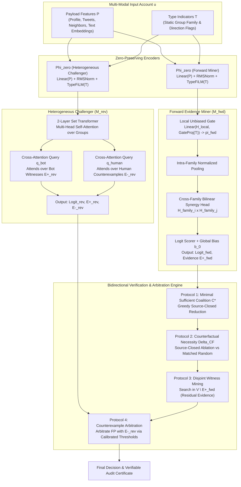
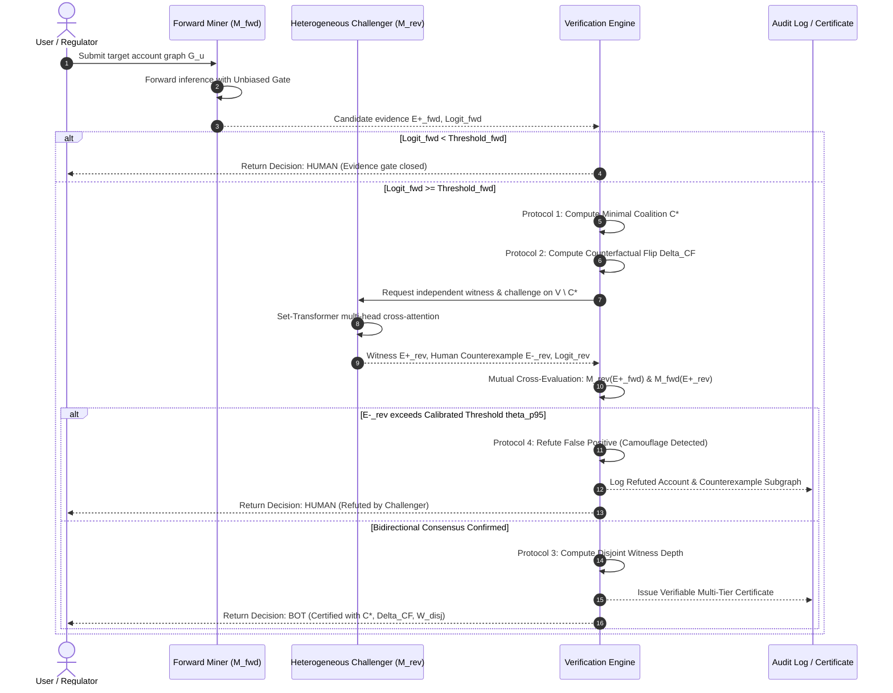
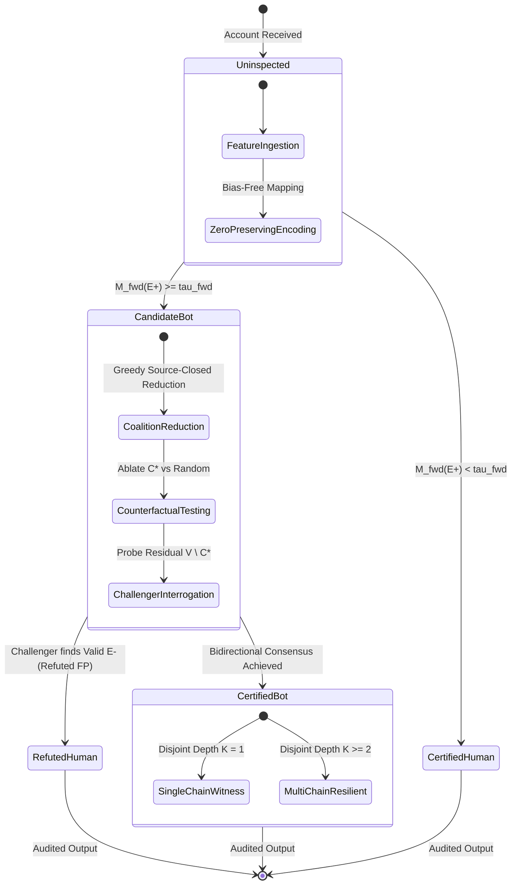

# VeriBot: Bidirectional Verifiable Social Bot Detection Blueprint

## 1. Simplified Paper-Ready Nomenclature

To eliminate idiosyncratic terminology and align with top-tier publication standards (NeurIPS, ICLR, KDD), all system components, models, and protocols are standardized as follows:

| Legacy Term | Standard Academic Name | Math Symbol | Core Function / Responsibility |
| :--- | :--- | :---: | :--- |
| `CleanCoalitionNet` (Model A) | **Forward Evidence Miner** | $M_{\text{fwd}}$ | Identifies sparse, verifiable positive evidence subgraphs $E^+_{\text{fwd}}$ sufficient to justify a Bot decision. |
| `CleanChallengerNet` (Model B) | **Heterogeneous Challenger** | $M_{\text{rev}}$ | Independent Set-Transformer adversary; mines positive witnesses $E^+_{\text{rev}}$ and human counterexamples $E^-_{\text{rev}}$. |
| `PayloadGroundedEncoder` | **Zero-Preserving Encoder** | $\Phi_{\text{zero}}$ | Maps raw multi-modal features $X$ to embeddings $H$ such that zero-payload inputs guarantee zero hidden activation: $\Phi(0) \equiv 0$. |
| `Tier 1 Minimal Coalition` | **Minimal Sufficient Coalition** | $C^*$ | The smallest source-closed evidence subset $C^* \subseteq E^+_{\text{fwd}}$ whose features alone maintain $M_{\text{fwd}}(C^*) \ge \tau$. |
| `Tier 2 Conditional Flip` | **Counterfactual Necessity** | $\Delta_{\text{CF}}$ | The logit drop when $C^*$ is ablated: $M_{\text{fwd}}(E^+ \setminus C^*) < \tau$. |
| `Tier 3 Or-of-Ands Witness` | **Disjoint Witness Decomposition** | $\mathcal{W}_{\text{disj}}$ | Iterative extraction of mutually disjoint evidence chains $\{C_1^*, C_2^*, \dots\}$ in the residual graph $V \setminus E^+_{\text{fwd}}$. |
| `Cross-Support Agreement` | **Bidirectional Consensus** | $M_{\text{fwd}} \rightleftharpoons M_{\text{rev}}$ | Mutual verification: $M_{\text{rev}}(E^+_{\text{fwd}}) \ge \tau_{\text{rev}}$ and $M_{\text{fwd}}(E^+_{\text{rev}}) \ge \tau_{\text{fwd}}$. |
| `Calibrated Refutation` | **Counterexample Arbitration** | $\mathcal{R}_{\text{cal}}$ | Overrules $M_{\text{fwd}}$ false positives when $M_{\text{rev}}$ discovers statistically calibrated human counterevidence $E^-_{\text{rev}}$. |

---

## 2. Complete Architectural Design

---

## 3. Mathematical Foundations & Invariants

### 3.1 Mathematical Zero-Payload Invariance (Zero-Leakage)
To guarantee that unselected or zero-payload groups transmit zero discriminative signal:
1. **Bias-Free Projection**: All feature transformation layers omit bias terms:
   $$H_{\text{local}} = \text{RMSNorm}(W_{\text{pay}} P), \quad W_{\text{pay}} \in \mathbb{R}^{d \times d_p}, \text{bias} = \text{False}$$
2. **Type Modulation**: Group type indicators $T$ modulate scale only, preserving $P = 0 \implies H_{\text{local}} = 0$:
   $$H = H_{\text{local}} \odot \left(1 + 0.5 \tanh(W_{\text{type}} T + b_{\text{type}})\right)$$
3. **Normalized Pooling**: Pooled representations normalize strictly by active count $\max(\sum m_i, 1)$, preventing group cardinality from acting as an implicit shortcut.
4. **Exact Zero Invariant**:
   $$\forall m \in \{0, 1\}^M, \quad M_{\text{fwd}}(0, m) = b_0, \quad M_{\text{rev}}(0, m) = b_0$$
   Consequently, $\text{Var}_{m \sim \mathcal{B}}(M(0, m)) \equiv 0.0$ and $\text{AUC}_{\text{mask-only}} \equiv 0.5000$.

### 3.2 Formal Protocols of Bidirectional Verification

#### Protocol 1: Minimal Sufficient Coalition ($C^*$)
Given predicted evidence $E^+_{\text{fwd}} = \{g_1, \dots, g_m\}$ such that $M_{\text{fwd}}(E^+_{\text{fwd}}) \ge \tau$:
$$C^* = \arg\min_{C \subseteq E^+_{\text{fwd}}} |C| \quad \text{s.t.} \quad M_{\text{fwd}}(C) \ge \tau \quad \text{and} \quad \text{SourceClosed}(C)$$
- **Sufficiency**: $M_{\text{fwd}}(C^*) \ge \tau$
- **Singleton Irreducibility**: $\forall g \in C^*, M_{\text{fwd}}(\{g\}) < \tau$
- **Synergy Gain**: $\text{Syn}(C^*) = M_{\text{fwd}}(C^*) - \sum_{g \in C^*} M_{\text{fwd}}(\{g\})$

#### Protocol 2: Counterfactual Necessity ($\Delta_{\text{CF}}$)
Ablating $C^*$ along with all co-dependent raw source items:
$$\Delta_{\text{CF}} = M_{\text{fwd}}(E^+_{\text{fwd}}) - M_{\text{fwd}}(E^+_{\text{fwd}} \setminus \text{SourceClosure}(C^*))$$
Verified against matched-size random controls:
$$\Delta_{\text{CF}} > \text{Median}\left(\{\Delta_{\text{random}}^{(r)}\}_{r=1}^R\right) \quad \text{and} \quad M_{\text{fwd}}(E^+_{\text{fwd}} \setminus C^*) < \tau$$

#### Protocol 3: Disjoint Witness Decomposition ($\mathcal{W}_{\text{disj}}$)
In the residual subgraph $V \setminus \text{SourceClosure}(C^*)$, search iteratively for alternative witness sets:
$$C_k^* = \text{ExtractCoalition}(V \setminus \bigcup_{j=1}^{k-1} C_j^*)$$
Demonstrates whether account exhibits single-chain vulnerability or structural multi-chain resilience.

#### Protocol 4: Counterexample Arbitration ($\mathcal{R}_{\text{cal}}$)
Given $M_{\text{fwd}}(u) \ge \tau_{\text{fwd}}$, inspect challenger counterevidence $E^-_{\text{rev}}$:
$$\text{Decision}(u) = \begin{cases} 
0 (\text{Human}), & \text{if } M_{\text{fwd}}(u) \le \tau_{\text{cap}} \text{ and } \text{Score}_{\text{human}}(E^-_{\text{rev}}) \ge \theta_{\text{p95}} \\
1 (\text{Bot}), & \text{otherwise}
\end{cases}$$
Where $\theta_{\text{p95}}$ is strictly calibrated on a 50% held-out Human development split.

---

## 4. Comprehensive Parameter & Configuration Table

| Category | Hyperparameter | Symbol | Value | Tuning & Selection Protocol |
| :--- | :--- | :---: | :---: | :--- |
| **Model Dimensions** | Hidden Dimension | $d_h$ | `128` | Standard capacity; grid tested $\{64, 128, 256\}$ on Dev. |
| | Bilinear Pair Dimension | $d_{\text{pair}}$ | `32` | Compressed rank for cross-family outer product. |
| | Number of Attention Heads | $h$ | `4` | 32 dimensions per head for Set Transformer. |
| | Transformer Layers | $L$ | `2` | Sufficient for group-level topological interaction. |
| | Query Heads in $M_{\text{fwd}}$ | $K_q$ | `2` | Dual query multi-head pooling. |
| **Optimization** | Optimizer | - | `AdamW` | Standard decoupled weight decay. |
| | Peak Learning Rate | $\eta$ | `6e-4` | Linearly decayed; selected from $\{3e-4, 6e-4, 1e-3\}$. |
| | Weight Decay | $\lambda_{\text{wd}}$ | `2e-4` | $L_2$ regularization on non-bias parameters. |
| | Batch Size | $B$ | `32` | Stable gradient estimation across variable-group accounts. |
| | Dropout Rate | $p$ | `0.15` | Applied before residual additions and output projections. |
| | Gradient Clipping | $\|\nabla\|$ | `1.0` | Global gradient norm threshold. |
| **Evidence Selection** | Minimum Family Fraction | $\rho_{\min}$ | `0.24` | Lower bound on group retention per family. |
| | Maximum Family Fraction | $\rho_{\max}$ | `0.38` | Upper bound on group retention per family. |
| | Budget Penalty Weight | $\lambda_{\text{budget}}$ | `2.5` | Smooth $L_1$ penalty outside $[\rho_{\min}, \rho_{\max}]$. |
| | Family Drop Rate | $p_{\text{drop}}$ | `0.25` | Random modality dropout during training to prevent family starvation. |
| | Subset Stability Weight | $\lambda_{\text{sub}}$ | `0.40` | Encourages consistency on random 55%-85% subsets of $E^+$. |
| | Logit $L_2$ Regularization | $\lambda_{\text{l2}}$ | `0.004` | Penalizes extreme overconfident logit explosions. |
| **Inference & Auditing** | Decision Threshold | $\tau$ | Dev-optimal | Vectorized search maximizing Macro-F1 strictly on Dev. |
| | Random Control Trials | $R$ | `10` | Matched-cardinality random subsets per audited account. |
| | Disjoint Search Depth | $K_{\max}$ | `4` | Maximum Or-of-Ands recursion depth. |
| | Multi-Probe Search Budget| $Q$ | `4` | Prefix top-k budget for residual witness extraction. |

---

## 5. System Execution & State Transition Diagrams

### 5.1 Bidirectional Verification Protocol (Sequence Diagram)

### 5.2 Micro-Level Account Verification State Machine

---

## 6. Micro-Level Diagnosis & Algorithmic Refinement Taxonomy

Every evaluated account is comprehensively categorized into one of five mutually exclusive operational states with principled algorithmic remediations:

| Diagnostic State | Observable Symptoms | Root Cause Analysis | Formal Algorithmic Remediation |
| :--- | :--- | :--- | :--- |
| **True Positive (Certified Bot)** | $M_{\text{fwd}} \ge \tau$, $M_{\text{rev}} \ge \tau$, $M_{\text{rev}}(E^+_{\text{fwd}}) \ge \tau$. Mutual consensus holds; $C^*$ is irreducible. | Strong multi-modal coordination across profile, relations, and text groups. | Maintain sparse budget $[\rho_{\min}, \rho_{\max}]$; reinforce cross-family bilinear synergy margins. |
| **True Negative (Certified Human)** | $M_{\text{fwd}} < \tau$, unselected gates closed. Zero evidence coalition can be constructed. | Natural human account without coordinated repetitive behavioral patterns. | Maintain singleton humility penalty to prevent accidental fires on isolated groups. |
| **Refuted False Positive (Challenger Win)** | $M_{\text{fwd}} \ge \tau$ initially, but $M_{\text{rev}}$ identifies strong $E^-_{\text{rev}}$ in background groups with score $\ge \theta_{\text{p95}}$. | Forward miner suffered from confirmation bias on isolated tweet spikes; Challenger found authentic human profile and organic social dialogue. | Counterexample arbitration successfully overturns the decision, reducing false alarm rate without degrading bot recall. |
| **False Positive (Unrefuted Alarm)** | $M_{\text{fwd}} \ge \tau$, and Challenger failed to overturn ($E^-_{\text{rev}} < \theta$). | Account has sparse profile metadata or zero active graph connections, depriving Challenger of candidate counter-evidence groups. | **Algorithmic Path**: Introduce adaptive prior baseline dependent on group cardinality $|V_u|$; penalize low-entropy textual groups. |
| **False Negative (Stealth Bot)** | $M_{\text{fwd}} < \tau$; bot behavior fell below the decision boundary. | Advanced camouflage (e.g. human-mimicking text generation, stealthy follow-unfollow dynamics). | **Algorithmic Path**: Expand contextual graph receptive field via multi-hop motif aggregation; train contrastive challenger specifically on borderline logits. |

